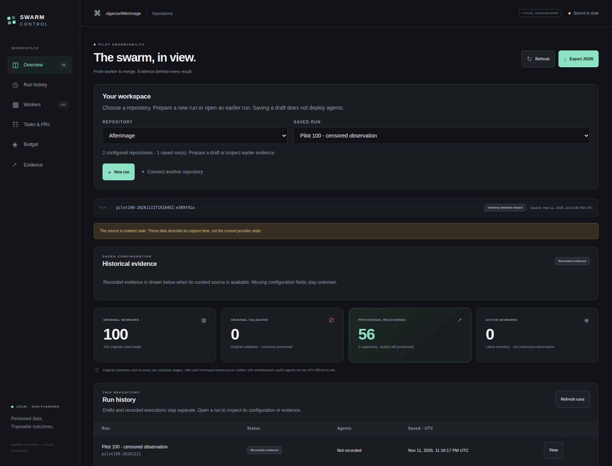

# Swarm Control

A controller for coding agents working on independent GitHub repositories.
It assigns tasks, starts isolated Codex workers in Modal, retrieves patches,
enforces budgets and ownership, and integrates reviewed changes through passing
GitHub Actions. OpenAI supplies the model; Modal supplies temporary machines.
The coordinator currently runs on one host.

## Open the app

With Git and Python 3.12 or newer installed, run these commands in a terminal
on Linux, macOS or Windows through WSL:

```sh
git clone https://github.com/slgarza/swarm-control.git
cd swarm-control
./easy-run
```

Easy Run creates a local Python environment, installs the controller on first use
and opens the browser. Keep the terminal open; press Ctrl+C there to stop the
server. Next time, run `./easy-run` from the same folder. No cloud workers start
when you open the app. Use `./easy-run --no-open` to print the URL without opening
a browser, or `./easy-run --port 8788` if the default port is busy.

**[Guía para principiantes en español](docs/GETTING_STARTED.es.md)** ·
**[English quickstart with a local example](docs/QUICKSTART.md)**

In the browser, connect a prepared local repository, choose tasks and concurrent
agents, check the plan and save a draft. A separate, confirmed **Run agents** action uses
the existing source, gateway and budget gates. The app does not configure service
accounts or authorize a budget for you. Start with
[repositories and runs](docs/RUNS.md) for the complete workflow.



Workspace captured on November 11, 2026, at 17:24 Mexico City time (23:24 UTC),
showing sealed historical evidence from 16:23 Mexico City time (22:23 UTC):
100 original failed workers, 56 provisional product recoveries and two separate
support recoveries. Final quality, billed cost and AFK comparison remain unknown.

**Start with the [local quickstart](docs/QUICKSTART.md)** to understand the system
without credentials or cloud resources. Then follow the
[two-agent walkthrough](docs/TWO_AGENT_WALKTHROUGH.md) to run real workers using
your own GitHub, Modal and OpenAI accounts and an authorized budget.

This project is being developed toward the Telnyx X Prize: at least 100 useful
agents working on one real repository, beating a strong AFK pipeline on merged
green PRs per hour and per dollar. The [first ten-agent pilot](https://github.com/slgarza/Afterimage/blob/main/docs/swarm/pilot10-2026-11-10.md)
delivered ten reviewed, merged PRs, including one coordinator code repair.
**The 100-agent requirement and AFK efficiency comparison remain unproven.**

## Documentation

Open a [local evidence dashboard](docs/DASHBOARD.md) with
`swarm-control dashboard --snapshot /path/to/curated-evidence.json`.
It shows worker outcomes, separately attributed recovery, PR/CI links and financial
unknowns. The loopback viewer makes no provider calls or execution/accounting writes.

| Guide | What it explains |
| --- | --- |
| [Documentation index](docs/README.md) | Reading paths, terminology and current capabilities |
| [Beginner guide in Spanish](docs/GETTING_STARTED.es.md) | Download, open, connect a repository, choose tasks and understand real execution |
| [Quickstart](docs/QUICKSTART.md) | Easy Run, a tiny local target, baseline tests and a local plan |
| [Architecture](docs/ARCHITECTURE.md) | Who writes code, where it runs, how patches reach GitHub and where state lives |
| [Two-agent walkthrough](docs/TWO_AGENT_WALKTHROUGH.md) | Own-account setup, real issues, budget, execution, review, PRs, merge and cleanup |
| [Project reference](docs/PROJECTS.md) | Every configuration field and the task format |
| [Operations](docs/OPERATIONS.md) | Commands, side effects, flags and integration gates |
| [Repositories and runs](docs/RUNS.md) | Connect targets, choose concurrent agents, save drafts and explicitly launch through the browser or CLI |
| [Next pilot](docs/NEXT_PILOT.md) | Small completion experiment, scoped context, CI scheduling and matched AFK gates |
| [Operational feedback](docs/OPERATIONS_SAFETY.md) | Failure brakes, durable action reservations, CI diagnosis and conservative scaling advice |
| [Deployment preflight](docs/DEPLOYMENT_PREFLIGHT.md) | Read-only source, ledger, GitHub and resource checks before a separately authorized deployment |
| [Spend reporting](docs/BILLING.md) | Provider cost evidence, source freshness and local reservations without invented account balances |
| [Budget migration](docs/BUDGET_MIGRATION.md) | Read-only proposals and separately authorized cumulative increases preserving every allocation |
| [Troubleshooting](docs/TROUBLESHOOTING.md) | Setup, budget, worker and integration failures |
| [Presentation](docs/contest/PRESENTATION.md) | Seven-minute outline, real pilot results and remaining contest requirements |
| [Target assessment](docs/contest/TARGET-ASSESSMENT.md) | Why Afterimage suits the next collision pilot and what the final benchmark target needs |
| [Benchmark and evidence](docs/contest/BENCHMARK.md) | Fair AFK comparison; [reporting checklist and template](docs/contest/EVIDENCE.md) |

The interface and example use English; the beginner guide is also available in
Spanish. The standalone extraction and tutorial are tested offline; their
documentation does not imply a new paid cohort ran.

## What lives where

| Location | Responsibility |
| --- | --- |
| This repository | Runner, budget gateway, state, integration, tests and operational docs |
| Target repository | Application code, root `swarm.toml`, tasks, instructions and CI |
| Target checkout's ignored `.swarm/` | Durable budget ledger, claims, patches and private logs |
| Modal | Temporary worker VMs and trusted model gateway |
| GitHub | Issues, source history, reviewed PRs and CI |

Afterimage is the first client project. Its source, tasks and private run evidence
are not copied into this controller. Each target uses a separate controller
process. Git worktrees share their original checkout's ledger and dispatcher lock.

## Try the local example

Use Python 3.12 with venv support and Git. GitHub CLI and Modal authentication
are needed for operations that access those services.

```sh
git clone https://github.com/slgarza/swarm-control.git
cd swarm-control
python3.12 -m venv .venv
source .venv/bin/activate
python -m pip install -e '.[dev]'
python examples/create_demo.py ../swarm-demo
cd ../swarm-demo
python3 -m unittest discover -s tests -v
swarm-control plan D01 D02 --project swarm.toml --workers 2 --synchronized --base HEAD
```

Expected: two baseline tests pass and the plan shows two ready tasks with
`live_execution_enabled: false`. No agent has written code at this stage.
The helper creates a separate local Git repository and refuses an existing folder.
`plan` reads local metadata and creates no cloud resources. It reports potential
concurrency, not live readiness. See [Quickstart](docs/QUICKSTART.md) for details.

Use `swarm-control preflight D01 D02 --project swarm.toml --workers 2 --synchronized --base HEAD`
for a read-only preparation report that also inspects existing local claims,
admission allowance and cached spend. Add `--online` only to permit GitHub GETs.
Exit zero covers the checked source-preparation scope; `launch_ready` remains
false and budget/provider/authorization blockers remain explicit. See the
[deployment preflight guide](docs/DEPLOYMENT_PREFLIGHT.md).

Connect another repository using [project configuration](docs/PROJECTS.md).
Read [operations](docs/OPERATIONS.md) before any paid run. Semantic review remains
explicit. The local dashboard can prepare run drafts, explicitly request execution
and inspect historical evidence. Backlog preparation, gateway deployment and
reviewed integration still use the controller workflow.

## Capacity and remaining proof

The runner accepts cohorts of up to 100 workers when the target explicitly sets
that capacity and has an authorized allowance. Defaults remain ten workers and
disabled live execution. Dispatch is bounded and checkpoints each completed task.
`--allow-overlap` permits declared shared-file work in isolated checkouts; the
integrator applies patches on the current base, uses three-way application when
needed, and validates the combined tree. Actual conflicts produce a durable repair
receipt; they still need an assigned repair and review.

Targets can optionally configure paired token/request pacing in the trusted
gateway. It uses verified input counts plus maximum output and a shared bounded
queue; it does not verify provider quota or refund retained money. Coding sessions
default to 300 seconds; `--timeout 1800` is an explicit opt-in with longer bounded
gateway expiry. These settings require reviewed deployment and allowance, and
cannot establish useful live overlap by themselves.

Scheduling uses local SQLite. Separate dispatcher and integration locks cover Git
worktrees sharing one checkout, not other clones or hosts. Private target cloning
still needs a scoped authentication adapter. Review and integration remain assisted.

Offline tests cover the new capacity, backpressure and collision paths. Real provider
capacity, useful 100-agent overlap and efficiency remain unproven. The next steps
are a second real target, measured 25 → 50 → 100 cohorts and the strong AFK comparison
with separately authorized budgets. See [scaling](docs/SCALING.md).

Before discussing budget, run `swarm-control budget status --project /path/to/target/swarm.toml`.
It distinguishes retained local admission reservations from provider-reported
spend and unknown account credit. Explicit billing synchronization can read the
OpenAI Costs API; imported observations keep their source and scope. See
[spend reporting](docs/BILLING.md). A spent local allocation is not a provider bill.

## Validation

From the controller checkout with its virtual environment active:

```sh
python -m unittest discover -s tests -p 'test_*.py'
ruff check --isolated swarm_control tests examples
python -m compileall -q swarm_control examples
```

Tests cover worker recovery, budget accounting, integration gates, repository
isolation and configuration. CI also creates the documented demo in a temporary
directory, runs its baseline and planner, and verifies disabled execution.
These checks make no paid model or Modal calls.

## Origin

The controller was extracted from [Afterimage commit 2217882](https://github.com/slgarza/Afterimage/commit/2217882c3d5597bbb92a4ae28bc8a2e02ccedb0b).
Afterimage remains a separate client project with its original completed tasks,
private runtime evidence and cumulative budget. The tutorial contains original,
small Python examples rather than copied application code.
