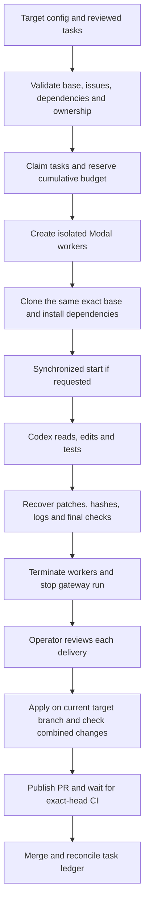

# How Swarm Control works

The implementation uses a central controller and independent coding workers.
Each worker owns one task. Workers do not directly exchange messages, dynamically
recruit peers or resolve shared-file conflicts. The current controller rejects
overlapping ownership before dispatch.

## Responsibilities

| Component | Runs where | Responsibility |
| --- | --- | --- |
| Controller and integrator | Operator's computer or one controlled server | Select target/tasks, reserve budget, provision workers, validate and publish reviewed changes |
| Codex worker process | One isolated Modal VM per task | Read code, call the model, edit files, execute commands and tests |
| Model | OpenAI's service | Interpret context and select the worker's next response/tool action |
| Budget gateway | Trusted Modal application | Authenticate temporary worker tokens, reserve/settle model usage, hold the real API key |
| GitHub | Target repository and Actions | Source history, issues, PRs and independent CI |
| Local ledger/artifacts | Target checkout's ignored `.swarm/` | Durable claims, cumulative allocations, exact patches and private evidence |

A single OpenAI account can serve multiple worker sessions. Each session has its
own task/context; we are not training or hosting a separate model for each VM.
The API key belongs to the operator's project. Modal operations use the workspace
selected by the operator's local authentication. App names and secret names are
identifiers, not credentials or access to the author's infrastructure.

## End-to-end flow

A successful `run` ends with validated patches, not merged PRs. `integrate`
implements the later review/publish/merge steps. The current operator chooses
when to invoke them and handles repairs that require further judgment.

## Inside a worker

The model receives the task instructions and relevant context. Codex executes its
tool actions, returns their outputs to the model and repeats the loop until the
task finishes or a limit is reached. The agent may correct failing tests during
that loop. A trusted helper then runs the configured project checks independently
and captures tracked, deleted and newly created files as an exact Git patch.

The worker must leave its Git HEAD unchanged and stay inside its assigned paths.
Ownership violations, prohibited files, failed final checks, missing artifacts or
changed patch hashes prevent the result from being accepted as validated. The
controller attempts recovery even after failures and records cleanup problems.
It does not silently start replacement workers or replenish budget.

All synchronized checkouts cross a barrier before their agents begin. A setup
failure breaks the barrier rather than pretending the full cohort started.
The VM caps remain 2 CPU/2 GiB, with up to 300 seconds of agent time and 1200 seconds
for the full lifecycle. This is a bounded pilot implementation.

## Model credentials and budget

The real OpenAI key is injected only into the gateway. A worker receives an
expiring token for one task/run. The gateway admits only its supported Responses
requests and tracks reservations in a durable Modal ledger. The local SQLite
ledger separately reserves cumulative model and infrastructure allowances across
probes and cohorts. See [gateway details](GATEWAY.md) for request policy and failure
accounting.

Reservations are not invoices. Failed or ambiguous requests may retain their
reservation. Local allocations are not automatically refunded when a run finishes.
The saved budget policy cannot be raised by simply editing `swarm.toml`; there is
currently no general budget-migration CLI. Existing pilot allocations must survive
any future, explicitly reviewed migration.

## State and integration boundaries

Worker states include `preparing`, `ready`, `working`, `checking`, `validated`,
`failed`, `rejected`, `needs_repair` and `needs_recovery`. The task ledger records
`running`, then `awaiting_integration` for a validated delivery, and `merged` only
after GitHub confirms integration. These represent different layers, not one
universal state machine.

The integrator binds a candidate to its worker patch digest, tested base and Git
tree. It runs all configured install/check commands in a fresh worktree. Publish
and merge require the reviewed patch hash. Merge requires all returned GitHub
Actions checks to succeed on the exact PR head, including the configured required
names. A changed base or candidate stops integration. One integrator must own the
merge sequence because the GitHub API's atomic head check does not lock the base.

The dispatcher lock coordinates Git worktrees sharing one Git common directory.
It does not coordinate other clones or hosts. Scheduling, budget and gateway
state are not yet a globally distributed control service.

## Source map

| File | Main responsibility |
| --- | --- |
| [project.py](../swarm_control/project.py) | Parse/validate target settings and verify Git origin |
| [modal_runner.py](../swarm_control/modal_runner.py) | Plan, admission, provisioning, event collection and cleanup |
| [modal_worker.py](../swarm_control/modal_worker.py) | Install/check commands and Git patch recovery inside the VM |
| [pilot_state.py](../swarm_control/pilot_state.py) | Local durable claims, budgets and activity summaries |
| [pilot_budget.py](../swarm_control/pilot_budget.py) | Gateway policy, reservations, token validation and accounting |
| [pilot_gateway.py](../swarm_control/pilot_gateway.py) | Modal HTTP gateway and authenticated administration functions |
| [pilot_integrate.py](../swarm_control/pilot_integrate.py) | Candidate validation, review acknowledgment, PRs and merge |
| [deployment.py](../swarm_control/deployment.py) | Deploy the gateway with the target's existing identifiers |

## What remains outside this implementation

Automatic backlog decomposition, peer-to-peer coordination, distributed leases,
shared-file repair, private-target clone authentication, unattended semantic review,
a dashboard and live cohorts above ten are future work. The [scaling roadmap](SCALING.md)
and [benchmark protocol](contest/BENCHMARK.md) explain how to evaluate those additions.

Related primary documentation: [OpenAI agents](https://developers.openai.com/tracks/building-agents),
[Modal sandboxes](https://modal.com/docs/guide/sandboxes),
[Modal workspaces](https://modal.com/docs/guide/workspaces).
