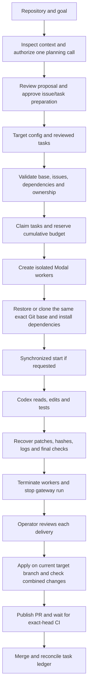

# How Swarm Control works

The implementation uses a central controller and independent coding workers.
Each worker owns one task. Workers do not directly exchange messages, dynamically
recruit peers or resolve shared-file conflicts. Overlapping ownership is rejected
by default; `plan` and `run --allow-overlap` record shared ownership explicitly
while preserving each worker's scope checks and isolated checkout.

## Responsibilities

| Component | Runs where | Responsibility |
| --- | --- | --- |
| Controller and integrator | Operator's computer or one controlled server | Select target/tasks, reserve budget, provision workers, validate and publish reviewed changes |
| AI planning controller | Operator's computer, with one explicitly authorized OpenAI call | Inspect bounded source, propose tasks, validate dependencies and await approval before issue/task creation |
| Codex worker process | One isolated Modal VM per task | Read code, call the model, edit files, execute commands and tests |
| Model | OpenAI's service | Interpret context and select the worker's next response/tool action |
| Budget gateway | Trusted Modal application | Authenticate temporary worker tokens, reserve/settle model usage, hold the real API key |
| GitHub | Target repository and Actions | Source history, issues, PRs and independent CI |
| Local ledger/artifacts | Target checkout's ignored `.swarm/` | Durable claims, cumulative allocations, exact patches and private evidence |

A single OpenAI account can serve multiple worker sessions. Each session has its
own task/context; we are not training or hosting a separate model for each VM.
The API key belongs to the operator's project. Modal operations use the workspace
selected by the operator's local authentication. App names and secret names are
identifiers, not credentials or access to the author's infrastructure.

## End-to-end flow

A successful `run` ends with validated patches, not merged PRs. `integrate`
implements the later review/publish/merge steps. The current operator chooses
when to invoke them and handles repairs that require further judgment.

Existing reviewed task files can enter at the target-configuration stage without
an AI planning call. Local `plan`/`runs plan` inspect those task files; **Plan work**
is the separately budgeted proposal workflow. Neither operation launches coding
workers. See [AI planning](AI_PLANNING.md).

## Inside a worker

The model receives the task instructions and relevant context. Codex executes its
tool actions, returns their outputs to the model and repeats the loop until the
task finishes or a limit is reached. The agent may correct failing tests during
that loop. A trusted helper then runs the configured project checks independently
and captures tracked, deleted and newly created files as an exact Git patch.

The worker must leave its Git HEAD unchanged and stay inside its assigned paths.
Ownership violations, prohibited files, failed final checks, missing artifacts or
changed patch hashes prevent the result from being accepted as validated. The
controller attempts recovery even after failures and records cleanup problems.
It does not silently start replacement workers or replenish budget.

All synchronized checkouts cross a barrier before their agents begin. A setup
failure breaks the barrier rather than pretending the full cohort started. The
dispatcher submits at most the requested worker count and checkpoints completed
reports and ledger states before admitting more tasks. Checkpoint failure stops
new submissions; submitted workers still finish through their recovery paths.
The VM caps remain 2 CPU/2 GiB. Agent time defaults to 300 seconds with a
1200-second full lifecycle; explicit `--timeout 1800` opts into 1800 seconds of
coding and a 2700-second lifecycle. Longer sessions do not increase any allowance
or authorize new spending. A profile may opt into up to 100 workers; its default is ten.

## Model credentials and budget

For worker execution, the real OpenAI key is injected only into the gateway.
The optional local AI planner separately uses the operator's saved/session key
for its confirmed request to OpenAI; that key never enters a worker manifest or
controller subprocess environment. A worker receives an
expiring token for one task/run. The gateway admits only its supported Responses
requests and tracks reservations in a durable Modal ledger. The local SQLite
ledger separately reserves cumulative model and infrastructure allowances across
probes and cohorts. See [gateway details](GATEWAY.md) for request policy and failure
accounting. The gateway's single serving container accepts 120 HTTP inputs and
limits concurrent provider requests to `runtime.gateway_concurrency` (default 20,
maximum 100). Capacity waiting is bounded to 15 seconds before a 429 response
without a provider call or budget reservation. A synchronized 100-worker cohort
needs configured gateway capacity and matching real API quota. The runner checks
local capacity before allocation and authenticated gateway admission capacity
before sandbox launch. Missing deployed capacity is accepted only for cohorts of
at most 20, for compatibility with older gateways. A failed admission capacity check
stops the run and retains its allocation. The operator still must ensure the
supplied HTTP URL belongs to that gateway deployment.

Reservations are not invoices. Failed or ambiguous requests may retain their
reservation. Local allocations are not automatically refunded when a run finishes.
The saved budget policy cannot be raised by simply editing `swarm.toml`; there is
an explicit [budget migration workflow](BUDGET_MIGRATION.md), also used by the
reviewed GUI budget form. Existing pilot allocations survive every migration.

## State and integration boundaries

Progress distinguishes preparation, readiness, coding and checking phases. Final
worker outcomes include `validated`, `failed`, `rejected`, `needs_repair` and
`needs_recovery`. The task ledger records
`running`, then `awaiting_integration` for a validated delivery, and `merged` only
after GitHub confirms integration. These represent different layers, not one
universal state machine.

The integrator binds a candidate to its original worker digest, applied diff digest,
tested base and Git tree. It tries strict application on the current base. An
opt-in overlap manifest permits three-way application if strict application fails
and the worker base is an ancestor. Clean application reruns all configured
install/check commands in a fresh worktree. Conflicts preserve a `needs_repair`
receipt and original patch, then clean the partial application from that worktree.
No repair worker or additional budget is created automatically.

Publish and merge require the original reviewed patch hash; three-way candidates
also require the reviewed hash of `integration.patch`, the actual applied diff.
Merge requires all returned GitHub
Actions checks to succeed on the exact PR head, including the configured required
names. Check lists and open-PR admission are paginated with a 100-page bound and
fail on inconsistent/incomplete results. A changed base or candidate stops
integration. A candidate lock protects each preparation while a short shared
`integration.lock` covers Git worktree setup and credentialed publish/merge.
Install and validation run outside that shared lock. The bounded local
[pipeline](INTEGRATION_PIPELINE.md) prepares independent candidates while CI
waits remain unresolved. Changed bases require explicit revalidation.
Other merge clients still require coordination because GitHub's atomic
head check does not lock the base.

The dispatcher lock coordinates Git worktrees sharing one Git common directory.
It does not coordinate other clones or hosts. Scheduling, budget and gateway
state are not yet a globally distributed control service.

Browser-created profiles default to frozen Git bundle transport, supporting
public and private repositories without GitHub credentials in worker VMs. Direct
`github` worker transport supports public source. A bundle can carry the selected
local commit, but live issue/dependency and reviewed GitHub PR/CI gates still
apply. See [private repositories](PRIVATE_REPOSITORIES.md).

The target's ignored `.swarm/` holds worker/integration evidence and shared local
accounting. Browser credentials, planning reservations, setup jobs and preparation
originals instead live beside the private workspace registry. Keep that registry
and its companion folders outside Git; planning and credential storage enforce
that boundary. Saving a profile or planning allowance never replenishes the
target's worker ledger.

## Source map

| File | Main responsibility |
| --- | --- |
| [project.py](../swarm_control/project.py) | Parse/validate target settings and verify Git origin |
| [modal_runner.py](../swarm_control/modal_runner.py) | Plan, admission, provisioning, event collection and cleanup |
| [modal_worker.py](../swarm_control/modal_worker.py) | Install/check commands and Git patch recovery inside the VM |
| [pilot_state.py](../swarm_control/pilot_state.py) | Local durable claims, budgets and activity summaries |
| [pilot_budget.py](../swarm_control/pilot_budget.py) | Gateway policy, reservations, token validation and accounting |
| [pilot_gateway.py](../swarm_control/pilot_gateway.py) | Modal HTTP gateway and authenticated administration functions |
| [pilot_integrate.py](../swarm_control/pilot_integrate.py) | Candidate validation, review acknowledgment, PRs and merge |
| [deployment.py](../swarm_control/deployment.py) | Deploy the gateway with the target's existing identifiers |
| [workspace.py](../swarm_control/workspace.py) | Private repository registry, frozen run drafts, sealed history and explicit CLI launch |
| [dashboard.py](../swarm_control/dashboard.py) | Loopback evidence, CSRF-protected setup and explicit background controller operations |
| [onboarding.py](../swarm_control/onboarding.py) | Durable setup jobs, provider/repository actions and exact CLI previews |
| [planning.py](../swarm_control/planning.py) | Budget-reserved repository/goal model planning, bound human review and durable issue/task materialization |
| [planning_context.py](../swarm_control/planning_context.py) | Bounded tracked-source selection, credential exclusion and source drift bindings |
| [connections.py](../swarm_control/connections.py) | Personal local `.env`, session overrides and explicit provider verification |
| [source_bundle.py](../swarm_control/source_bundle.py) | Frozen private source delivery without controller credentials in coding VMs |
| [progress.py](../swarm_control/progress.py) | Safe worker phase/event observations, with unknown remote termination causes preserved |

## What remains outside this implementation

Peer-to-peer coordination, distributed leases,
autonomous conflict repair and unattended semantic
review remain future work. The local dashboard supports repository/run selection,
draft preparation, budgeted AI backlog proposals and historical evidence. AI plans
require human review and separate approval before issue/task creation; installation,
deployment, launch and semantic integration remain explicit actions. Larger cohorts and clean shared-file
integration have offline coverage; their real scale and throughput still need
evidence. The [scaling roadmap](SCALING.md) and [benchmark protocol](contest/BENCHMARK.md)
explain how to evaluate them.

Related primary documentation: [OpenAI agents](https://developers.openai.com/tracks/building-agents),
[Modal sandboxes](https://modal.com/docs/guide/sandboxes),
[Modal workspaces](https://modal.com/docs/guide/workspaces).
