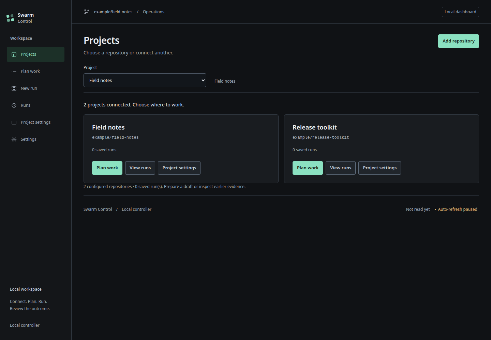
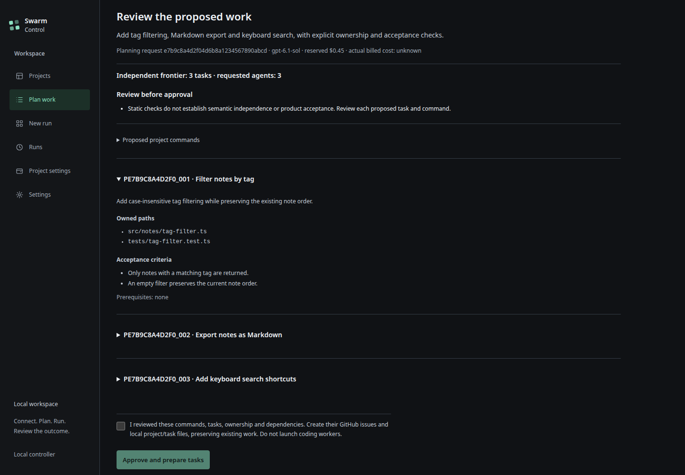
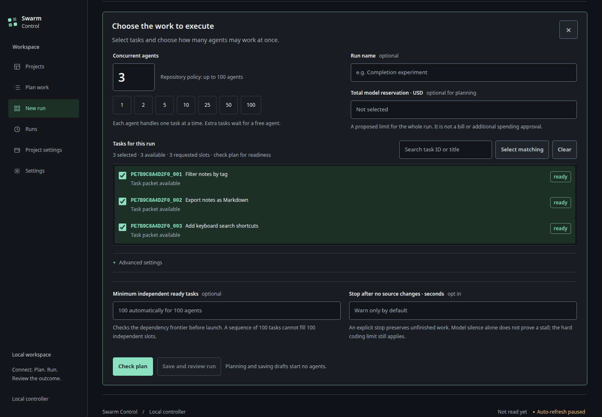
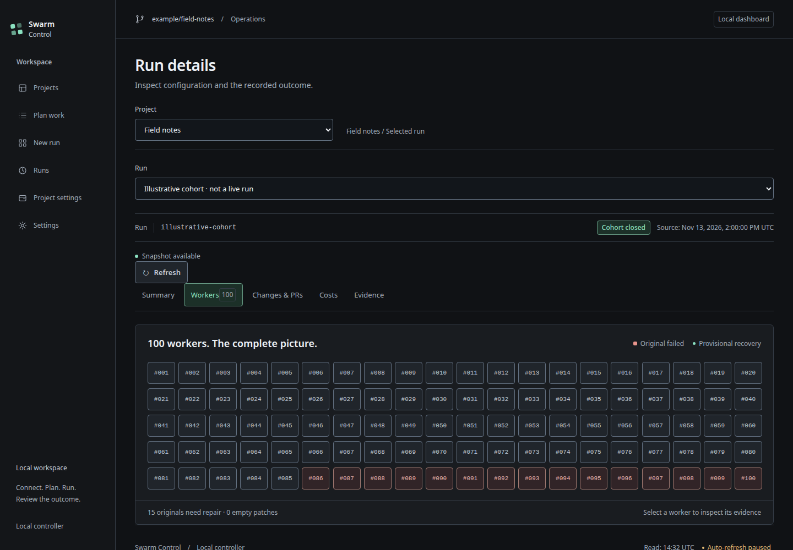
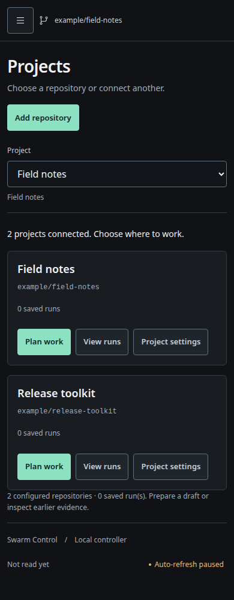

# Local dashboard

For a first launch, run `./easy-run` from the downloaded controller folder. It
installs the local environment and opens the workspace in your browser. Later
starts use the same command. The installed CLI offers `swarm-control start`;
`swarm-control dashboard --workspace` remains available for an existing workspace.

Workspace mode connects prepared local repositories, checks plans, saves drafts
and accepts an explicit, confirmed run request through the ordinary controller
gates. **Settings** holds personal `.env` and provider connections. **Projects**
handles clone/fork and local folders. **Plan work** proposes reviewed AI tasks
from a goal. **Project settings** holds preparation, publication, execution
allowances and deployment. **New run** configures work; **Runs** lists history.
Workers, changes, costs and evidence belong to the selected run's detail tabs.
URLs preserve the selected project/run and support refresh and browser history.
Navigation only reads local state. Keep the server terminal open during active
operations. Code review and merge remain explicit operator decisions. See
[browser setup](SETUP.md), [repositories and run history](RUNS.md) or the
[local quickstart](QUICKSTART.md).

The `--snapshot` and `--catalog` modes described below are read-only viewers. Workspace mode supports the explicit operations described above.

The evidence viewer shows a selected, curated snapshot in a browser. It reads
local JSON and serves local assets. It does not start workers, change a budget,
review code, merge PRs, refresh provider billing, or contact GitHub or Modal.
The interface uses English, USD amounts and UTC timestamps.

Choose a project, then a run to inspect. A project identifies a repository; a run
identifies a recorded execution or evidence source for it. Selecting either
changes the view. Launching workers remains an explicit controller operation with
its own budget and authorization gates.

## Workspace selection and read-only catalogs

In workspace mode, choose **Projects → Add repository** to clone/fork a GitHub
repository or inspect a local Git folder. The project selector applies to Plan
work, New run and Project settings. Open **Runs**, then a run, to inspect its
Summary, Workers, Changes, Costs or Evidence. Historical-only projects require a
matching local profile before they can prepare new work.

### Read-only catalog

Use an explicit catalog to register several local projects:

```sh
swarm-control dashboard --catalog /path/to/local-catalog.json --port 8787
```

```json
{
  "schema_version": 1,
  "workspace_label": "My projects",
  "projects": [
    {
      "id": "alpha",
      "label": "Alpha",
      "repository": "example/alpha",
      "runs": [
        {"id": "pilot-1", "label": "First pilot", "snapshot": "evidence/curated.json"}
      ]
    },
    {"id": "beta", "label": "Beta", "repository": "example/beta", "runs": []}
  ]
}
```

Relative snapshot paths resolve against the catalog directory. Snapshot paths stay on the
server and are not returned by the evidence API. The catalog is loaded at startup;
snapshot contents are reread on refresh. Restart this read-only catalog viewer to load a different catalog. Workspace
registration uses the separate live registry and its Projects controls.
The legacy `--snapshot` option still exposes one selected project/run.

Projects without evidence show an empty state, with no previous project's metrics
or invented results. A selected source must match its registered repository.
Project/run selection survives a bookmark and refresh; stale selection requests
cannot overwrite a newer choice. An expired delivery window is labeled closed
while unfinished integration retains an unknown final T1.

## Screenshots

### Current workspace

Captured on November 13, 2026, in the America/Mexico_City timezone. These are
browser captures of the shipped interface at controller commit
[`4a844bb`](https://github.com/slgarza/swarm-control/commit/4a844bba68a2e080ac8b84975cbf77b8c73a5e4b).
The repository, task, planning and worker data are controlled examples supplied
by an isolated local fixture. No personal credentials, customer source or local
account details appear. No model call, deployment or live worker run was made
to create this gallery. Worker tiles illustrate the layout rather than measured
agent concurrency or accepted delivery.

**Projects** selects a repository and provides GitHub clone/fork or local-folder
setup without mixing it with run evidence.



**Plan work** reviews proposed commands, ownership, acceptance and dependencies
before explicit approval of issue and task preparation.



**New run** selects ready tasks, concurrent agents and execution limits. Saving
a reviewed draft is separate from starting workers.



**Run details** keeps workers, changes, costs and evidence with the selected run.



The same navigation and forms adapt to a narrow browser viewport.



The [capture receipt](images/swarm-gallery-2026-11-13.json) records source hashes,
image dimensions, timestamps and browser checks. Private fixtures and raw
browser activity stay outside the repository.

Earlier interface captures are preserved in the [historical gallery](archive/DASHBOARD_HISTORY.md). They are not current operating instructions.

## Read-only snapshot viewer

From an installed checkout:

```sh
swarm-control dashboard --snapshot /path/to/curated-snapshot.json --port 8787
```

Open [http://127.0.0.1:8787](http://127.0.0.1:8787). Press Ctrl+C in the terminal
to stop the server. The default port is 8787. The server binds to loopback; it
has no command-line option to expose it on another interface. Choose a curated
snapshot explicitly rather than a worker log, ledger, report directory, or
credentials file.

The page rereads the selected file through `/api/snapshot`; it does not collect
new run evidence. Its source timestamp and stale indicator describe the
snapshot's freshness. A stale snapshot is not evidence that agents are still
running. Worker activity remains unknown unless the curated source supplies an
explicit activity observation. Missing or invalid source data produces a generic
unavailable response without including the file path or its contents.

The task view keeps original worker outcomes separate from locally recovered or
coordinator-repaired patches. A provisional item requires the source's explicit
qualification, nonempty binding checks that are all literally true, and valid
merged-state, attribution, PR, commit and timestamp fields. Product and support labels describe task scope; they do not establish delivery by
themselves. An empty patch remains empty even when a helper check passed.

A finished delivery clock does not accept the later quality window. AFK
comparison, provider invoices and unknown amounts stay unproven or blank unless
the curated source supplies the corresponding evidence. Authorized admission,
model estimates, retained uncertainty, exposure ceilings and reconciled billing
have distinct fields. An unconfirmed invoice is never displayed as billed cost.

The backend accepts at most 8 MiB of JSON and 1,000 unique task rows. It projects
an explicit field allowlist; raw logs, arbitrary input fields, secrets, account
payloads and local paths are not forwarded. Links are restricted to the selected
GitHub repository. In these read-only modes, the interface exposes the page, bundled assets,
`/api/catalog`, `/api/snapshot`, `/api/session` and `/api/health`, plus an empty
favicon response. Write methods are rejected. Workspace mode adds the guarded
setup, project, run and launch APIs. Host and Origin checks, a restrictive Content Security Policy, no-store responses and no
CORS support keep the viewer local and read-only.
Top-level navigation to the viewer page works when following a link from another
site; that exception does not expose the snapshot API to cross-site requests.

## Curated input

The viewer consumes the recovery delivery allowlist's top-level `repository`,
`run_id`, `as_of_utc`, `clock`, `rows`, `queue`, `final_metrics` and
`local_validation_summary`. Each task row identifies its original outcome and
patch hash, frozen product/support classification, binding checks and separately
attributed recovery. The source's T0 must precede its as-of timestamp; finished
clocks and qualifying merge/check observations must also fit that interval.
The viewer checks presentation consistency; it does not authenticate the source
or rerun independent semantic acceptance.

A target-owned adapter can optionally add:

| Field | Meaning |
| --- | --- |
| `dashboard_task_titles` | Mapping from task IDs to public, bounded display titles |
| `dashboard_activity` | Explicit `active_workers` and aware `observed_at`; missing or future observations stay unknown |
| `dashboard_links` | `report_url` and `tracking_url` within the selected GitHub repository |
| `dashboard_financials` | Separate new authorization, admission reserves, conservative model commitment, uncertainty, exposure, remaining admission and confirmed billed cost, with source kind/time |

Financial values are optional finite, nonnegative USD numbers. Missing values stay
null; a billed total also requires the source's explicit billing reconciliation.
The panel shows the source timestamp and marks an old capture as stale. Updating
the source file is the adapter's responsibility, outside this controller viewer.

## Checks

Run the focused checks from the controller checkout:

```sh
python -m unittest tests.test_dashboard tests.test_dashboard_catalog tests.test_dashboard_selection tests.test_dashboard_workspace tests.test_gui_setup tests.test_planning_http tests.test_navigation -v
```

These tests use synthetic curated data and temporary local HTTP servers. They
exercise projection, qualification, unknown costs, malformed input, source
read-only behavior, explicit workspace mutations, source/account bindings, route
limits and HTTP protections without paid resources. Node.js 24 is needed for
the routing contract tests. See the root [validation instructions](../README.md#validation).
