# Local dashboard

For a first launch, run `./easy-run` from the downloaded controller folder. It
installs the local environment and opens the workspace in your browser. Later
starts use the same command. The installed CLI offers `swarm-control start`;
`swarm-control dashboard --workspace` remains available for an existing workspace.

Workspace mode connects prepared local repositories, checks plans, saves drafts
and accepts an explicit, confirmed run request through the ordinary controller
gates. **Settings** holds personal `.env` and provider connections. **Projects**
handles clone/fork and local folders. **Plan work** proposes reviewed AI tasks
from a goal. **Project settings** holds preparation, publication, execution
allowances and deployment. **New run** configures work; **Runs** lists history.
Workers, changes, costs and evidence belong to the selected run's detail tabs.
URLs preserve the selected project/run and support refresh and browser history.
Navigation only reads local state. Keep the server terminal open during active
operations. Code review and merge remain explicit operator decisions. See
[browser setup](SETUP.md), [repositories and run history](RUNS.md) or the
[local quickstart](QUICKSTART.md).

The legacy evidence-only modes described below remain read-only.

The evidence viewer shows a selected, curated snapshot in a browser. It reads
local JSON and serves local assets. It does not start workers, change a budget,
review code, merge PRs, refresh provider billing, or contact GitHub or Modal.
The interface uses English, USD amounts and UTC timestamps.

Choose a project, then a run to inspect. A project identifies a repository; a run
identifies a recorded execution or evidence source for it. Selecting either
changes the view. Launching workers remains an explicit controller operation with
its own budget and authorization gates.

## Project selection

Use an explicit catalog to register several local projects:

```sh
swarm-control dashboard --catalog /path/to/local-catalog.json --port 8787
```

```json
{
  "schema_version": 1,
  "workspace_label": "My projects",
  "projects": [
    {
      "id": "alpha",
      "label": "Alpha",
      "repository": "example/alpha",
      "runs": [
        {"id": "pilot-1", "label": "First pilot", "snapshot": "evidence/curated.json"}
      ]
    },
    {"id": "beta", "label": "Beta", "repository": "example/beta", "runs": []}
  ]
}
```

Relative snapshot paths resolve against the catalog directory. Paths stay on the
server and are never sent to the browser. The catalog is loaded at startup;
snapshot contents are reread on refresh. Restart to change registered projects.
The legacy `--snapshot` option still exposes one selected project/run.

Projects without evidence show an empty state, with no previous project's metrics
or invented results. A selected source must match its registered repository.
Project/run selection survives a bookmark and refresh; stale selection requests
cannot overwrite a newer choice. An expired delivery window is labeled closed
while unfinished integration retains an unknown final T1.

## Screenshots

### Run planning and history

Captured on November 11, 2026, at 17:24 Mexico City time (23:24 UTC). The
Afterimage view preserves the original censored pilot observation from 22:23 UTC.
The planner and draft views use the actual local two-task example repository;
three distinct planning drafts were saved and no agents were deployed. Its
remote is an example address, not a verified live benchmark target. Missing
cost, execution and acceptance fields remain unknown.

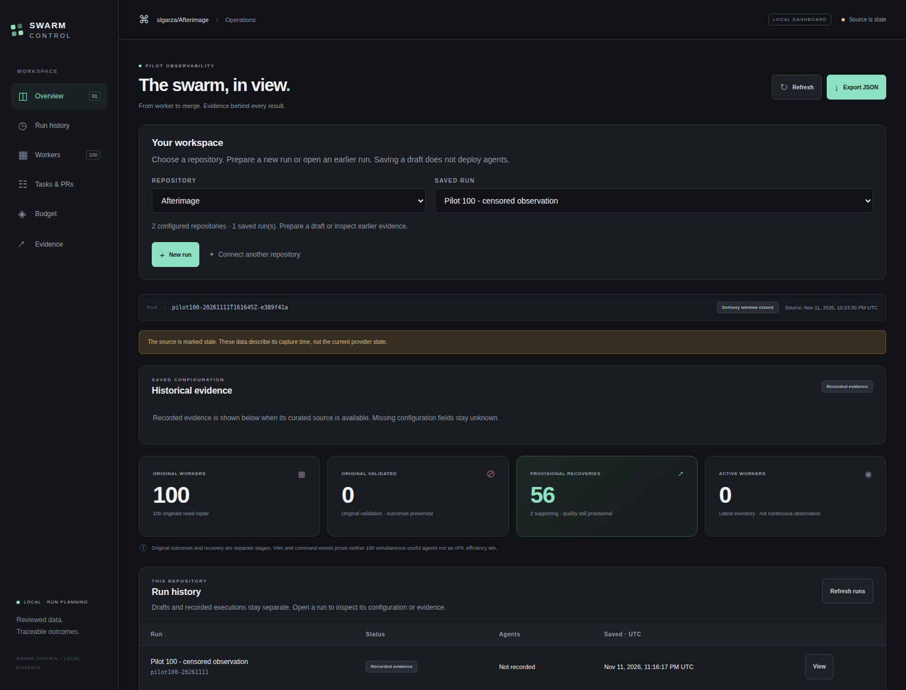

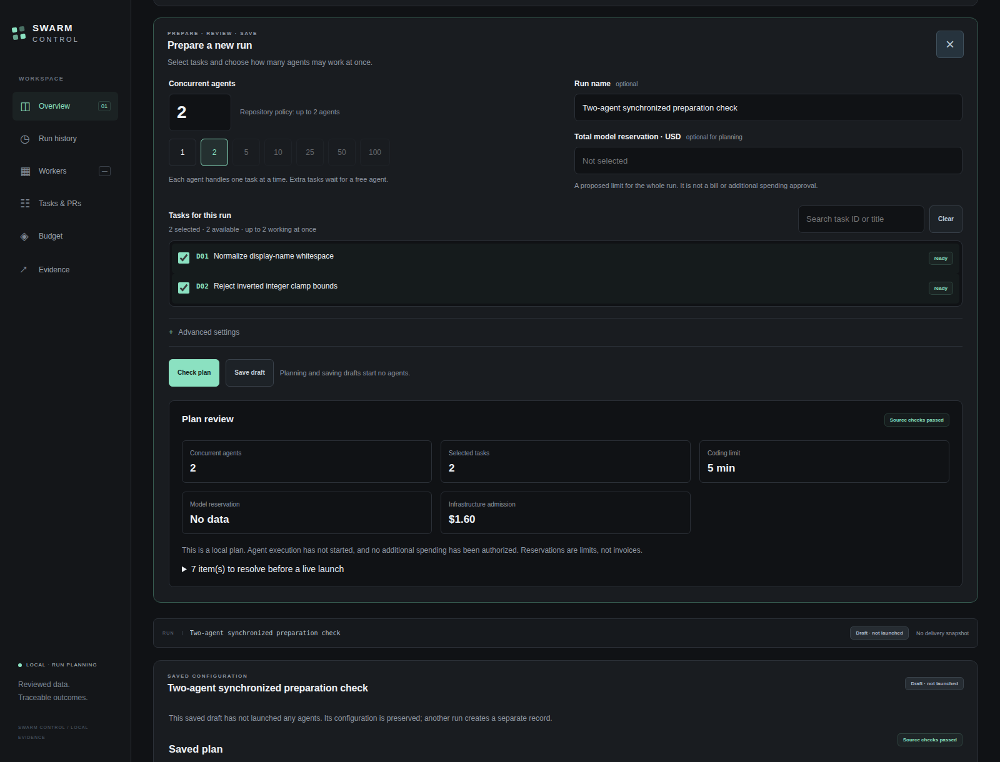

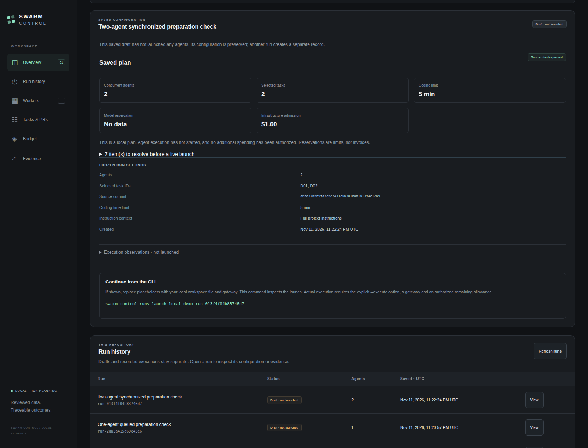

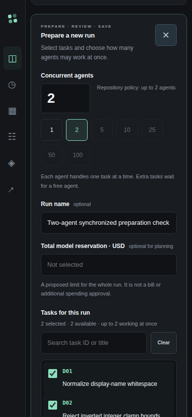

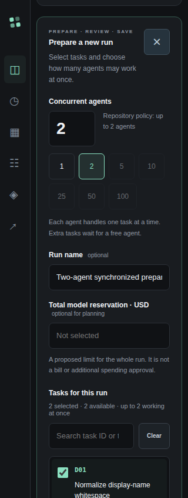

The [capture receipt](images/dashboard-run-gallery-2026-11-11.json) includes all
five image hashes, dimensions, source times and 30 real-browser checks. Earlier
failed or superseded QA attempts remain accounted for in that receipt; raw
browser activity and private runtime files remain outside the repository.

### Earlier evidence-only viewer

The following English captures use actual configured data from November 11,
2026, at 16:11 Mexico City time (22:11 UTC). They are historical views of an
incomplete pilot, with 100 original failed workers, 56 provisional product
recoveries and two separate supporting recoveries. Actual invoices and final
quality remain unknown. The empty view uses this public controller repository;
private project names, local paths, credentials and raw logs are excluded.
The [capture receipt](images/dashboard-gallery-2026-11-11.json) records image
dimensions, SHA-256 hashes, the source timestamp and seven browser checks.

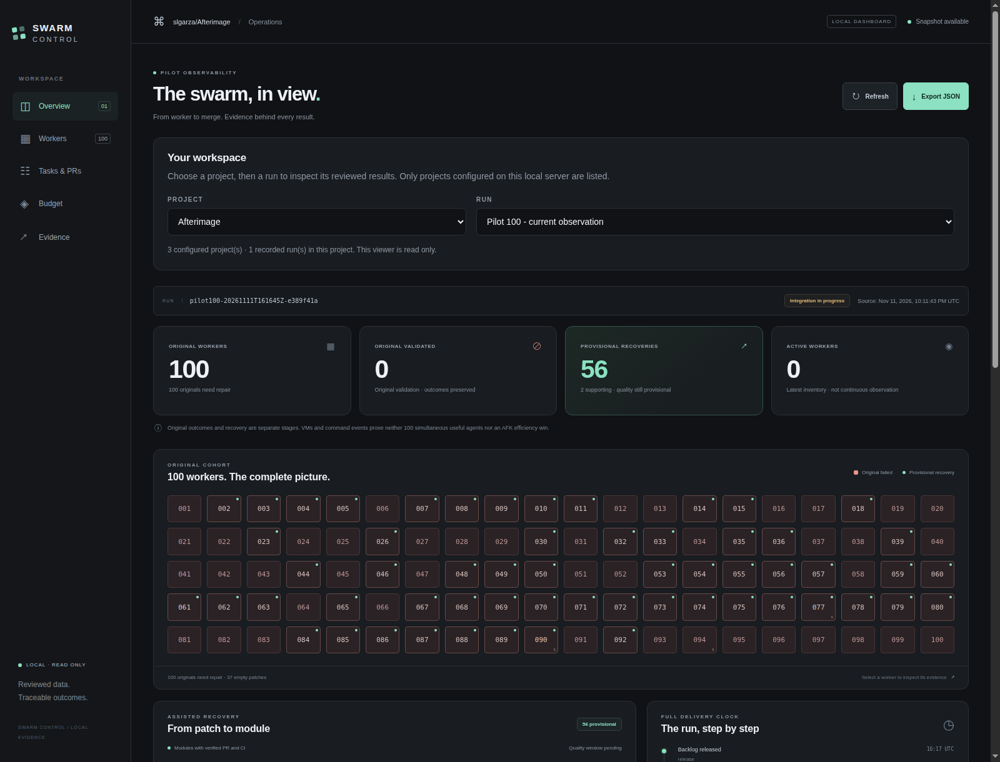

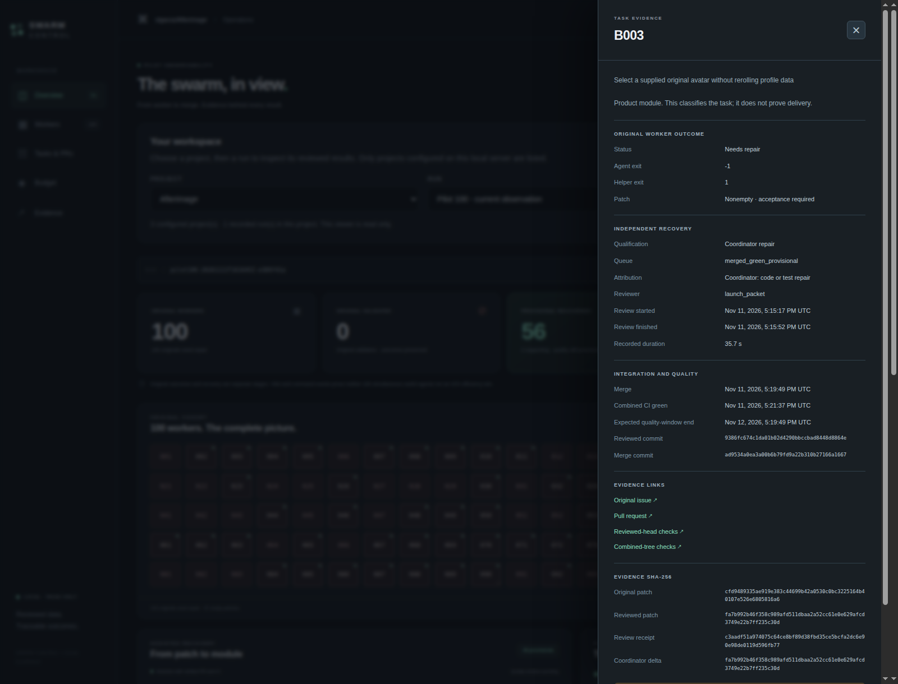

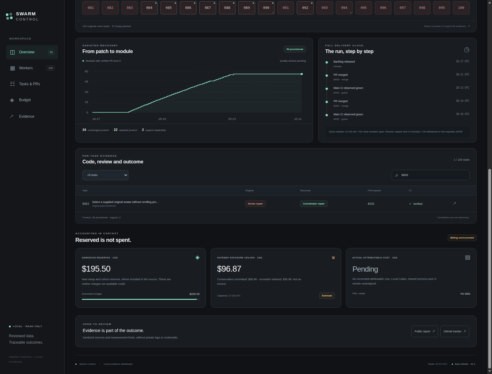

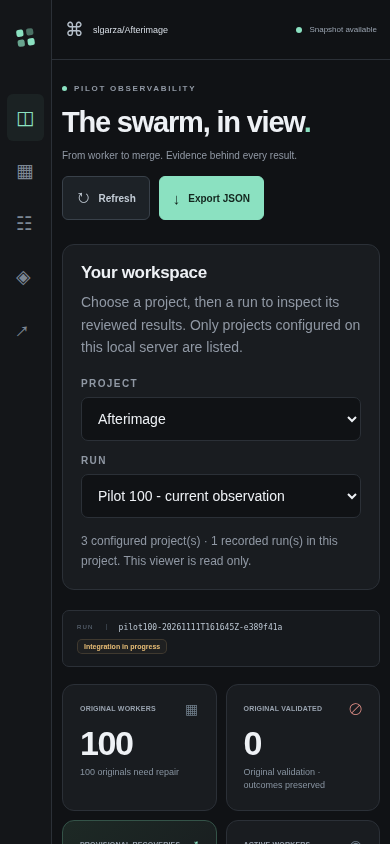

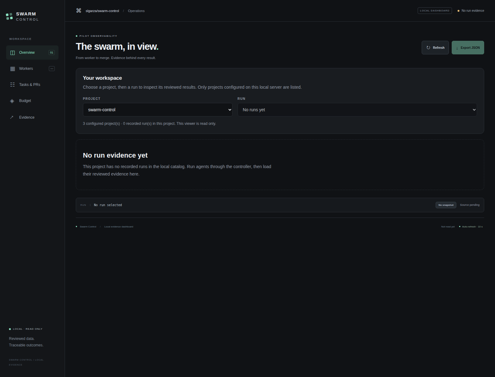

From an installed checkout:

```sh
swarm-control dashboard --snapshot /path/to/curated-snapshot.json --port 8787
```

Open [http://127.0.0.1:8787](http://127.0.0.1:8787). Press Ctrl+C in the terminal
to stop the server. The default port is 8787. The server binds to loopback; it
has no command-line option to expose it on another interface. Choose a curated
snapshot explicitly rather than a worker log, ledger, report directory, or
credentials file.

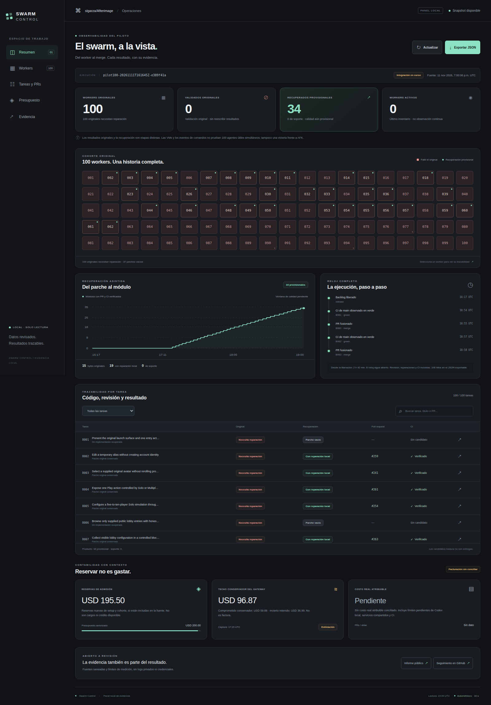

English view from November 11, 2026, at 20:53 UTC: 100 original failed
reports, 56 provisional product recoveries, two separate support recoveries and
unknown actual billing. This is a
historical capture while integration was still running, rather than a final
result or a hosted dashboard. The panel was built separately after the worker
cohort; it receives no feature credit in that cohort.

The page rereads the selected file through `/api/snapshot`; it does not collect
new run evidence. Its source timestamp and stale indicator describe the
snapshot's freshness. A stale snapshot is not evidence that agents are still
running. Worker activity remains unknown unless the curated source supplies an
explicit activity observation. Missing or invalid source data produces a generic
unavailable response without including the file path or its contents.

The task view keeps original worker outcomes separate from locally recovered or
coordinator-repaired patches. A provisional item requires the source's explicit
qualification, nonempty binding checks that are all literally true, and valid
merged-state, attribution, PR, commit and timestamp fields. Product and support labels describe task scope; they do not establish delivery by
themselves. An empty patch remains empty even when a helper check passed.

A finished delivery clock does not accept the later quality window. AFK
comparison, provider invoices and unknown amounts stay unproven or blank unless
the curated source supplies the corresponding evidence. Authorized admission,
model estimates, retained uncertainty, exposure ceilings and reconciled billing
have distinct fields. An unconfirmed invoice is never displayed as billed cost.

The backend accepts at most 8 MiB of JSON and 1,000 unique task rows. It projects
an explicit field allowlist; raw logs, arbitrary input fields, secrets, account
payloads and local paths are not forwarded. Links are restricted to the selected
GitHub repository. The HTTP interface exposes the page, its bundled assets,
an empty favicon response, `/api/catalog`, `/api/snapshot`, and `/api/health`. Write methods are
rejected. Host and
Origin checks, a restrictive Content Security Policy, no-store responses and no
CORS support keep the viewer local and read-only.
Top-level navigation to the public page works when following a link from another
site; that exception does not expose the snapshot API to cross-site requests.

## Curated input

The viewer consumes the recovery delivery allowlist's top-level `repository`,
`run_id`, `as_of_utc`, `clock`, `rows`, `queue`, `final_metrics` and
`local_validation_summary`. Each task row identifies its original outcome and
patch hash, frozen product/support classification, binding checks and separately
attributed recovery. The source's T0 must precede its as-of timestamp; finished
clocks and qualifying merge/check observations must also fit that interval.
The viewer checks presentation consistency; it does not authenticate the source
or rerun independent semantic acceptance.

A target-owned adapter can optionally add:

| Field | Meaning |
| --- | --- |
| `dashboard_task_titles` | Mapping from task IDs to public, bounded display titles |
| `dashboard_activity` | Explicit `active_workers` and aware `observed_at`; missing or future observations stay unknown |
| `dashboard_links` | `report_url` and `tracking_url` within the selected GitHub repository |
| `dashboard_financials` | Separate new authorization, admission reserves, conservative model commitment, uncertainty, exposure, remaining admission and confirmed billed cost, with source kind/time |

Financial values are optional finite, nonnegative USD numbers. Missing values stay
null; a billed total also requires the source's explicit billing reconciliation.
The panel shows the source timestamp and marks an old capture as stale. Updating
the source file is the adapter's responsibility, outside this controller viewer.

## Checks

Run the focused checks from the controller checkout:

```sh
python -m unittest tests.test_dashboard tests.test_dashboard_catalog tests.test_dashboard_selection -v
```

These tests use synthetic curated data and temporary local HTTP servers. They
exercise projection, qualification, unknown costs, malformed input, source
read-only behavior, route limits and HTTP protections without paid resources.
