# Archived dashboard captures

These captures and their recorded outcomes describe the interface and evidence
available on November 11, 2026. They are historical records, not current setup or
run instructions. Use the [current dashboard guide](../DASHBOARD.md),
[browser setup](../SETUP.md) and [current screenshot gallery](../DASHBOARD.md#screenshots).
Original image files and capture receipts retain their published paths and bytes.

### Historical: run planning and history, November 11

Captured on November 11, 2026, at 17:24 Mexico City time (23:24 UTC). The
Afterimage view preserves the original censored pilot observation from 22:23 UTC.
The planner and draft views use the actual local two-task example repository;
three distinct planning drafts were saved and no agents were deployed. Its
remote is an example address, not a verified live benchmark target. Missing
cost, execution and acceptance fields remain unknown.

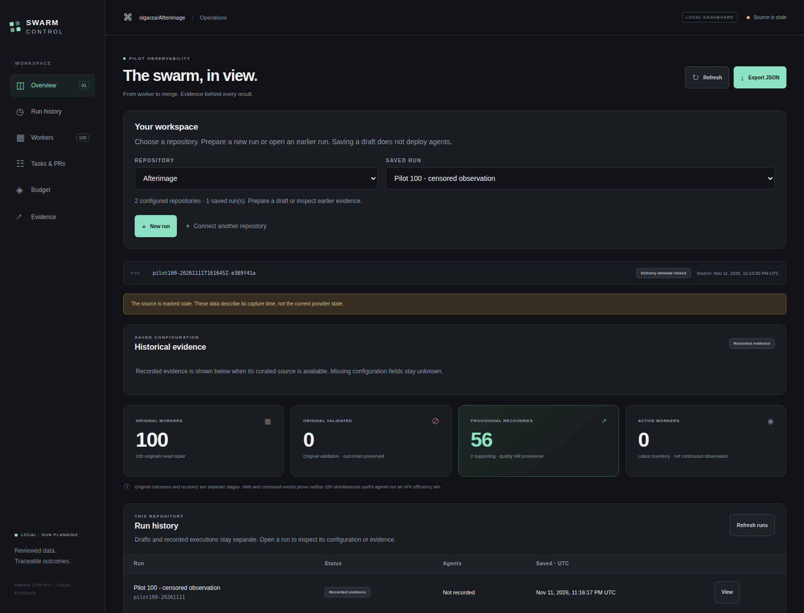

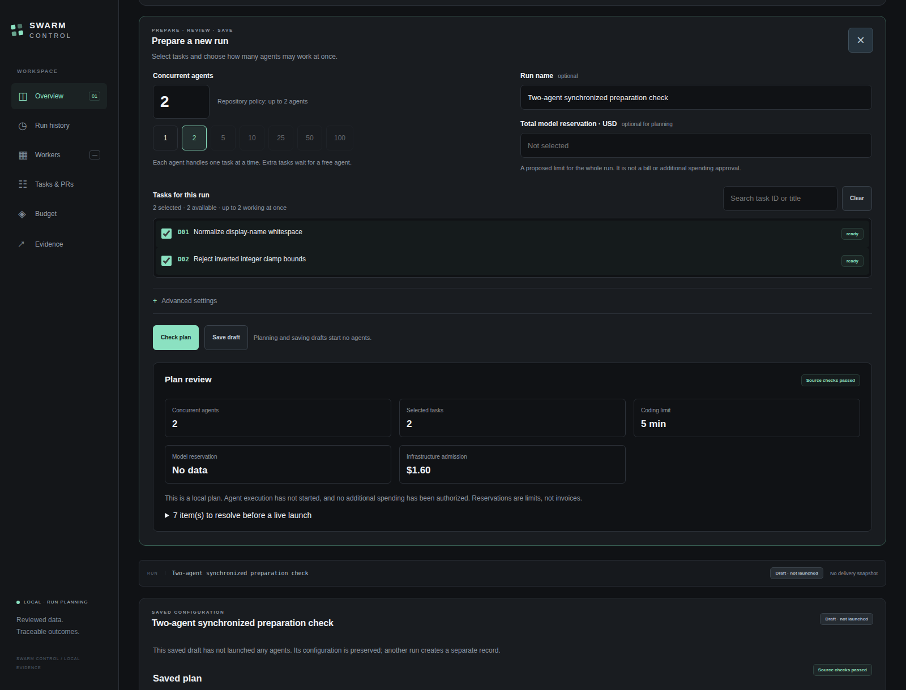

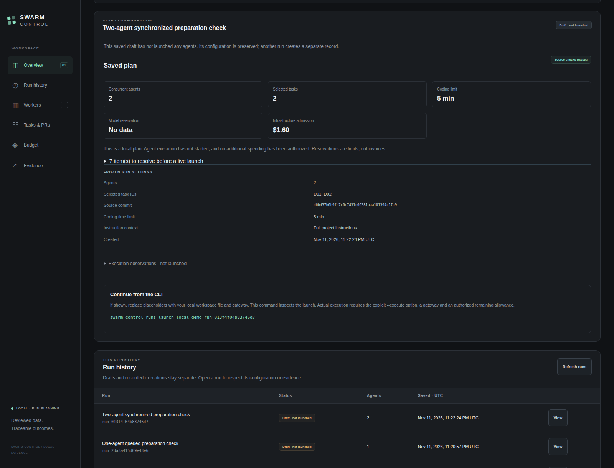

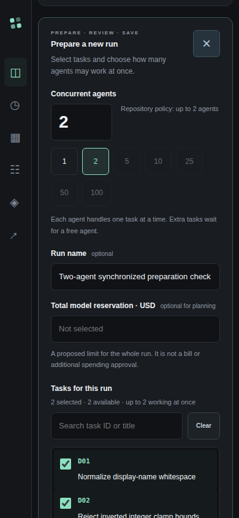

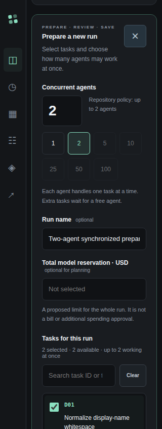

The [capture receipt](../images/dashboard-run-gallery-2026-11-11.json) includes all
five image hashes, dimensions, source times and 30 real-browser checks. Earlier
failed or superseded QA attempts remain accounted for in that receipt; raw
browser activity and private runtime files remain outside the repository.

### Historical: earlier evidence-only viewer

The following English captures use actual configured data from November 11,
2026, at 16:11 Mexico City time (22:11 UTC). They are historical views of an
incomplete pilot, with 100 original failed workers, 56 provisional product
recoveries and two separate supporting recoveries. Actual invoices and final
quality remain unknown. The empty view uses this public controller repository;
private project names, local paths, credentials and raw logs are excluded.
The [capture receipt](../images/dashboard-gallery-2026-11-11.json) records image
dimensions, SHA-256 hashes, the source timestamp and seven browser checks.

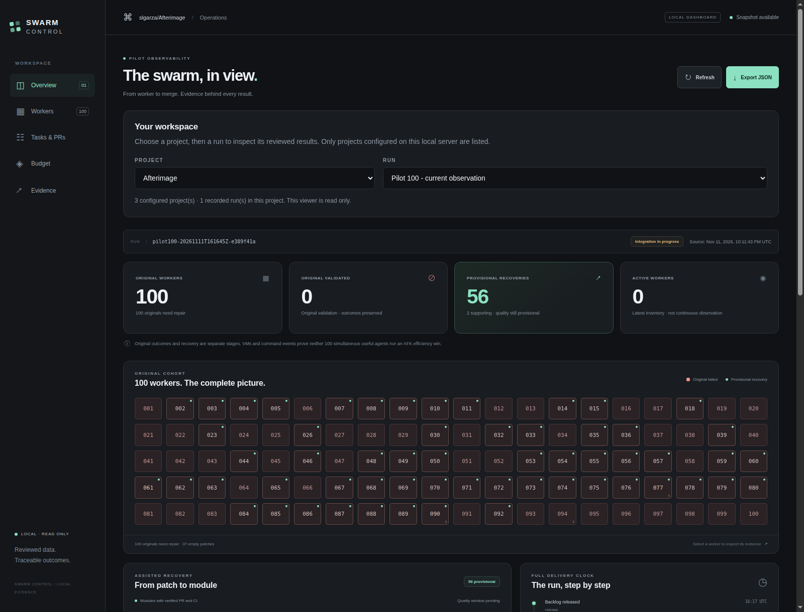

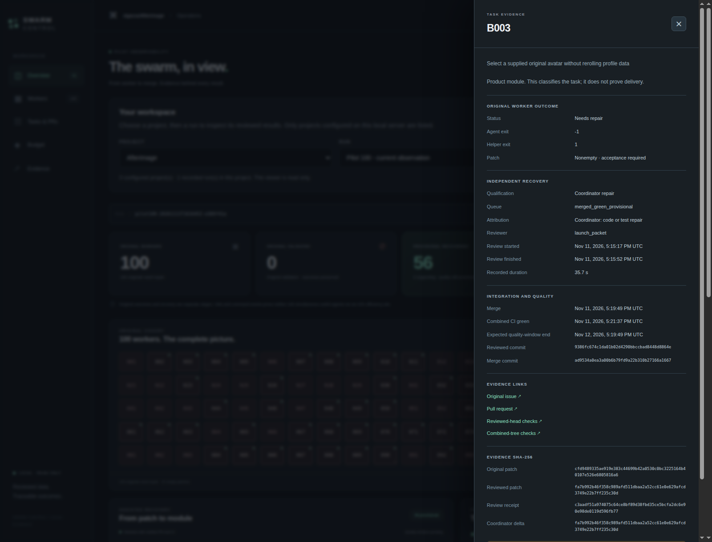

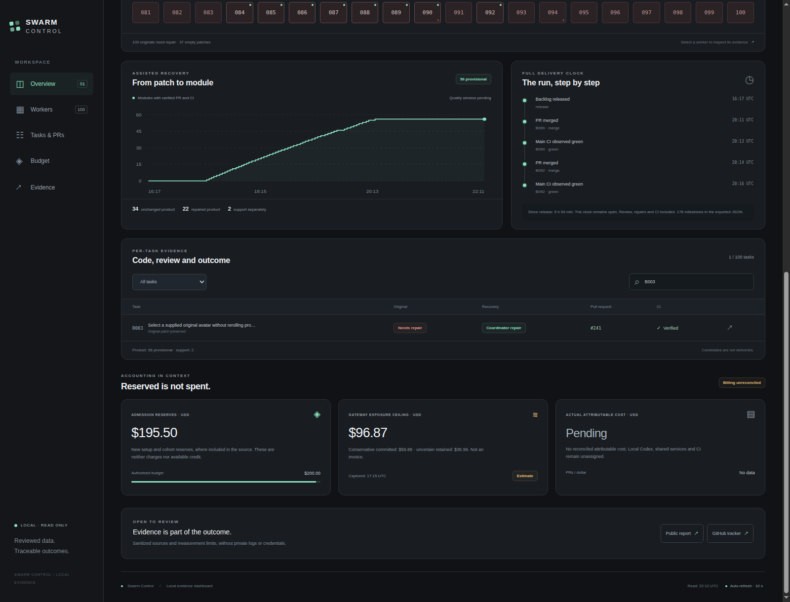

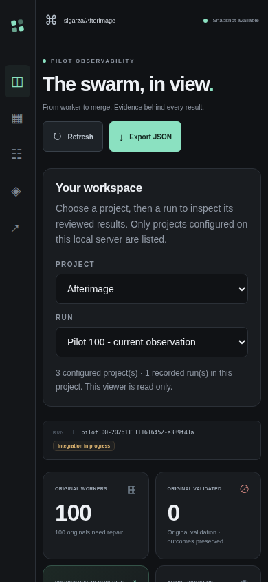

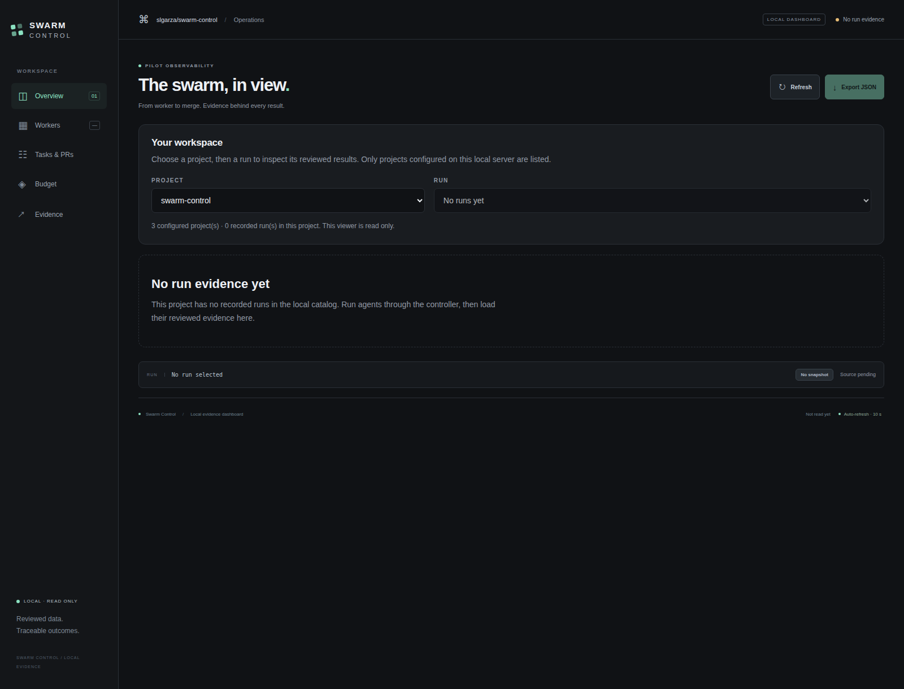

### Earlier hundred-worker observation

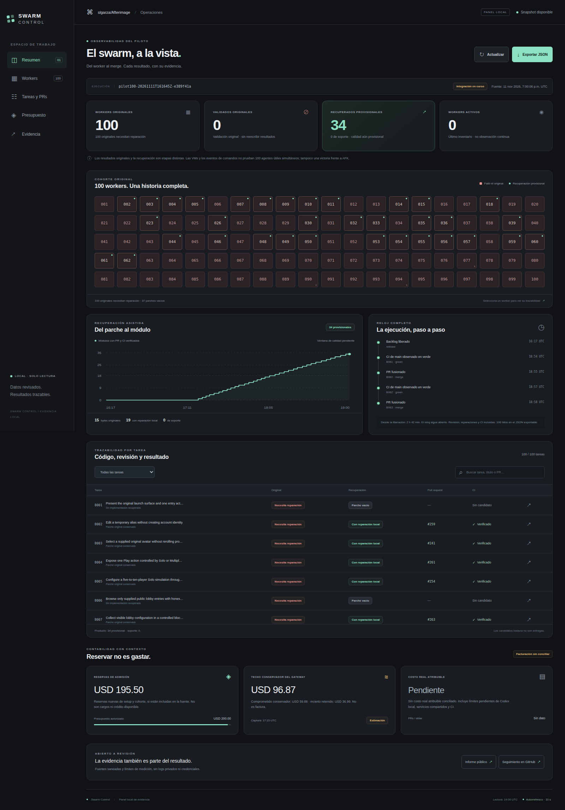

English view from November 11, 2026, at 20:53 UTC: 100 original failed
reports, 56 provisional product recoveries, two separate support recoveries and
unknown actual billing. This is a
historical capture while integration was still running, rather than a final
result or a hosted dashboard. The panel was built separately after the worker
cohort; it receives no feature credit in that cohort.
